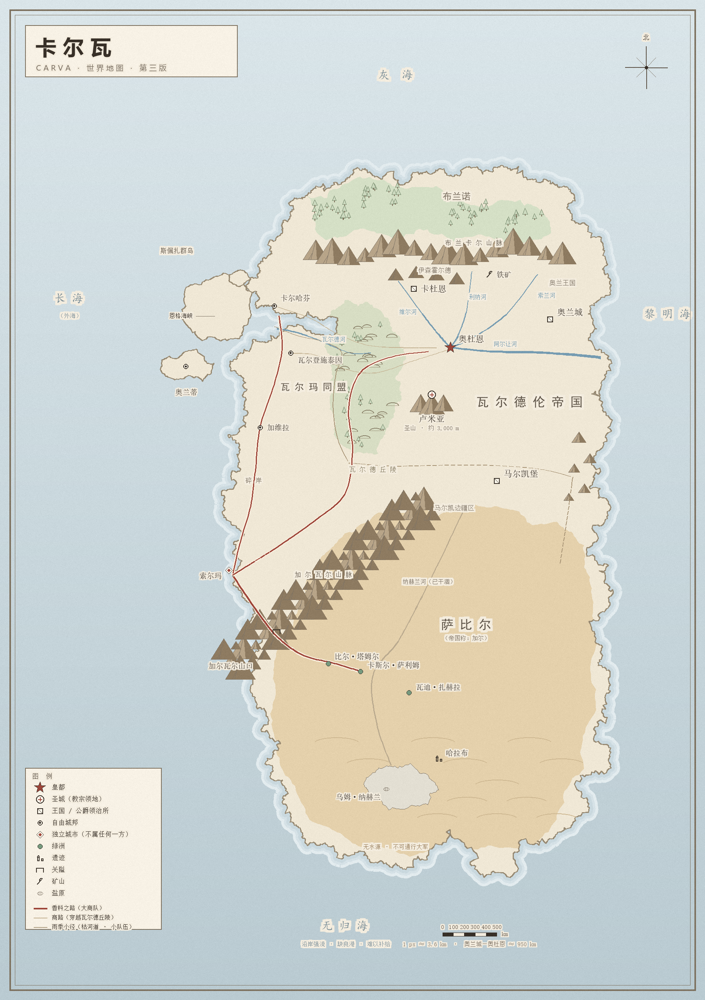

# 04 · 地理与世界形态

> **状态**：🟨 讨论中（大陆形态、三大区、四个节点已定；比例尺与等级带未定）　|　**最后更新**：2026-11-13　|　**依赖**：[02 创世](02-创世与宇宙观.md)、[03 历史](03-历史与纪元.md)、[09 经济](09-经济与贸易.md)、[10 语言](10-语言与命名.md)
>
> **本章使命**：让地图成为一台内容机器——每一片区域同时承担"风景、等级带、文化、资源、冲突"五重功能。

---

## 一、大陆形态（已定 · 2026-11-13 修订）

> **地图**：[地图-卡尔瓦.png](地图-卡尔瓦.png)（1800×2550，竖版）
> 代码绘制（`build_map.py`），城市坐标为数据行，增删一座城改一行即可。
> 旧版（东西向）存档于 `archive/地图-卡尔瓦-v1-东西向.png`。

| 项目 | 设定 |
|---|---|
| 走向 | **南北走向，东西窄、南北长**（参照南美洲的体量感） |
| 周围 | 四周环海，已知世界的边界就是海 |
| 大陆名 | **卡尔瓦（Carva）**，一陆三名（见 [10](10-语言与命名.md)） |
| 西岸 | **碎岸**：海岸线破碎，深湾密布，**多良港** |
| 东岸 | 相对平直，良港中等 |
| 南岸 | **平滑，几乎没有天然良港**——这是"南方无法海运"的物理原因 |
| 北岸 | 寒冷，针叶林带 |

### 为什么窄？

东西窄，意味着**任何一条南北向的路都不长**，而**东西向横穿大陆的路极其危险**。这一条直接决定了：
- 帝国必须南北纵向治理（一条主干道，一条河）；
- 南北之间的流动集中在少数几个口子；
- 而"口子"就是一切政治与经济的根源。

## 二、三大区（已定）

### 帝国 · 中／东／北

| 项目 | 内容 |
|---|---|
| 国名 | **瓦尔德伦帝国（The Valdren Empire）** |
| 性质 | 封建制 ＋ **教权至上**。皇帝管世俗，教宗管灵魂 |
| 核心 | 中部平原，皇都**奥杜恩**（三河交汇，偏东靠近东境边境），粮仓与道路网 |
| 北方 | **布兰诺**大区：针叶林与寒冷；**伊森霍尔德公爵领**（皇室世袭，主城卡杜恩，铁/煤/林地，**矿脉正在枯竭**） |
| 东部 | **奥兰**，帝国唯一的王国级头衔。葡萄、盐、旧贵族 |
| 西部 | 大小公爵领与伯爵领。与联盟之间隔着**瓦尔德丘陵**——不是天险，是一条必须互相往来的走廊 |
| 南部 | **马尔凯边疆区**：加尔瓦尔山脉北段 → 东境海岸山之间的地带。贫瘠、混乱、黑市与走私。**无天然防线** |
| 教宗国 | **卢米亚（Lumia）**，帝国境内的独立城市，皇帝无权干涉 |

### 马尔凯边疆区（范围已定）

| 项目 | 内容 |
|---|---|
| 范围 | **加尔瓦尔山脉北段 → 东境海岸山**之间的地带，马尔凯堡居中 |
| 尺寸 | 东西约 **1,400 km**，南北约 **550 km** |
| 北界 | 一条不算明确的界河／界桩线（帝国官方称"边墙"，实际是虚线） |
| 南界 | **大沙漠**——没有界，只有"再往南没人了" |
| 为什么是这个大小 | 大到足以养活走私网，小到帝国还能假装管得住 |

> **它的本质是"纸上的边疆"**：帝国在此驻军不多、收税不足、执法不达。
> 名义上是帝国领土，实际按"谁在当地说了算"运转。

### 西部海岸 · 自由城邦

| 项目 | 内容 |
|---|---|
| 联盟 | **瓦尔玛同盟（Walmar League）**，"持海之盟"，俗称"七港同盟" |
| 性质 | 松散商业同盟：共同防御、共同关税、共同航道，各城自治 |
| 地理 | **碎岸（The Broken Coast）**——海岸支离破碎，良港密布，腹地狭小 |
| 群岛 | **斯佩扎群岛（Spezza）**，海军根基 |
| 命脉 | **恩格海峡（En ga Narrows）**，西部海湾的瓶口 |
| 信仰 | 七女神，宽容 |

### 独立城市 · 索尔玛

| 项目 | 内容 |
|---|---|
| 地位 | **不属于任何一方**：既非联盟成员，也非帝国封臣 |
| 位置 | 加尔瓦尔山脉北端的出山口，唯一大商队路线的北端终点 |
| 经济 | 香料在此换手；对过境货物收"过城税"；也是联盟与帝国商人的中立交易所 |
| 为什么没人吞并它 | **谁动手，另一方必然介入**；而双方都需要一个中立的换手点 |
| 现实参照 | 拉古萨（杜布罗夫尼克）式的自由港 |

> **它不是"门"，是"铰链"。** 门可以被夺走，铰链只能被使用。
> 联盟恨它（本该是联盟的港口），帝国也恨它（要多付一层税）——
> **但两边都离不开它，这就是它活下去的全部理由。**

### 瓦尔德丘陵（帝国与联盟之间）

| 项目 | 内容 |
|---|---|
| 形态 | 东西宽约 250–350 km，南北绵延约 1,200 km |
| 地形 | **低矮、破碎的丘陵**，海拔不高，**林地密布** |
| 性质 | **不是天险**。坡缓、路多、无险可守 |
| 政治 | 名义上是帝国与联盟的边界，实际是**重叠主张地带**：两边都设税卡 |
| 河流 | **瓦尔德河**自丘陵西流，注入恩格湾 |
| 经济 | 有**数条商路**横穿；帝国与联盟的贸易大半走这里 |

> **欧洲中世纪的边界不是一条线，是一片林子。**
> 这片丘陵的用处恰恰在于"挡不住"：山脉会把两边隔成两个世界，而这里让两边**必须交往**。
> 商人在此**被收两次税**——西边是联盟的关，东边是帝国的关。两边都赚，商人两边都骂。

### 南部 · 萨比尔

| 项目 | 内容 |
|---|---|
| 帝国称呼 | **加尔（The Ghar）**——"空无之地"（贬义，源于无知） |
| 自称 | **萨比尔（Sabir）**——"忍耐之地" |
| 形态 | **一片巨大的沙漠**，面积占大陆的近三分之一 |
| 古文明 | **纳赫兰（Nahran）**——"河之国"，已亡 |
| 现存居民 | **拉哈尔人（Rahal）**——"迁徙者"，纳赫兰遗民，游牧与香料贸易 |
| 信仰 | **旧神**（未知，伏笔） |

---

## 三、四个节点（本章最重要的结构）

大陆上的商品与人都必须经过这四个地方，而它们的性质**完全不同**：

| 节点 | 谁控制 | 能过什么 | 性质 |
|---|---|---|---|
| **瓦尔德丘陵** （帝国 ↔ 联盟） | 两边都设卡，谁说了都不算 | 一切 | **双税走廊**——挡不住，也不该挡 |
| **大沙漠** （帝国 ↔ 萨比尔） | **没有人控制** | 小队伍、雨季、需向导 | **漏**，不是门 |
| **加尔瓦尔山口** （联盟 ↔ 萨比尔） | 联盟重兵把守 | **大规模商队** | 全大陆唯一的大车队陆路 |
| **索尔玛** （山口北端） | **独立城市** | 香料换手 | **铰链**，不是门 |

### 这一个结构解决了四件事

**① 索尔玛不是"门"，是"铰链"。**
门可以被夺走，铰链只能被使用。它在山口北端，香料出山的第一站，
之后分两路：一路向北沿联盟海岸出海，一路向东北穿越瓦尔德丘陵进入帝国。

> 联盟恨它（本该是联盟的港口），帝国也恨它（要多付一层税）。
> **但两边都需要一个中立的换手点，这就是它活下去的全部理由。**

**② 帝国与联盟之间的边界不是线，是一片林子。**

> **欧洲中世纪的边界本来就不是一条线。**
> 瓦尔德丘陵低矮、破碎、路多，**挡不住任何人**——而这正是它的用处。
> 山脉会把两边隔成两个世界，这里却让两边**必须交往**：商人在这片林子里被收**两次税**。

**③ 帝国的香料不是"进口"，是两种价钱。**

| 渠道 | 路线 | 代价 |
|---|---|---|
| **正规** | 索尔玛 → 瓦尔德丘陵 → 帝国（两次关税） | 贵，但合法、稳定、量大 |
| **走私** | 卡斯尔·萨利姆 → 枯河道 → 马尔凯边疆区 | 便宜，但季节性、小规模、要命 |

**这就是马尔凯人口复杂、黑市盛行、帝国无心管理的物理原因。**

**④ 联盟的垄断是地理特权，但它只垄断了一半。**

联盟垄断的不是"香料"，是**海路**。陆路的终点在索尔玛，而索尔玛不属于它。
所以联盟最赚钱、最焦虑的事，是**想办法把索尔玛吃下来又不敢吃**。

### 为什么南方没有海运？

三条原因叠加，缺一不可：

1. **缺少天然良港**——南岸平滑，没有避风湾（地图上是画出来的，不是写出来的）。
2. **沿途无法补给**——海岸之外是纯粹的沙漠，没有淡水，没有村庄。
3. **沿岸强流**——南部外海有一条自西向东的强流，船去得成，回不来。

> 于是**"无归海"不再只是一个恐怖的地名，而是一句判决。**
> 联盟试过，失败了不止一次。每一次失败都让这个地名更硬。

---

## 四、比例尺（已定 · 2026-11-13）

| 项目 | 设定 |
|---|---|
| **锚点** | **奥兰城 — 奥杜恩 ≈ 950 km**（参照明斯克—柏林，直线约 950 km） |
| 换算 | **1 px ≈ 3.6 km**（地图 1800×2550） |
| 大陆南北 | **约 6,350 km** |
| 大陆东西 | **约 3,950 km**（最宽处） |
| 体量参照 | **接近南美洲**（南美南北约 7,400 km） |

### 关键距离（写作时直接引用）

| 路线 | 直线距离 | 步行(30km/日) | 驿马接力(60km/日) | 商队(25km/日) |
|---|---|---|---|---|
| 奥兰城 → 奥杜恩 | 950 km | 31 日 | 15 日 | 38 日 |
| 奥杜恩 → 卢米亚 | 506 km | 16 日 | **8 日** | 20 日 |
| 奥杜恩 → 卡杜恩（伊森霍尔德） | 637 km | 21 日 | 10 日 | 25 日 |
| 奥杜恩 → 马尔凯堡 | 1,296 km | 43 日 | 21 日 | 51 日 |
| 奥杜恩 → 卡尔哈芬（联盟） | 1,664 km | 55 日 | 27 日 | 66 日 |
| 奥杜恩 → 索尔玛 | 2,887 km | 96 日 | 48 日 | 115 日 |
| 索尔玛 → 卡斯尔·萨利姆 | 1,525 km | 50 日 | 25 日 | 61 日 |

### 这个尺度解释了什么（重要）

1. **帝国太大，皇帝管不动。** 奥杜恩到奥兰城的消息要走**一个月**。所以东境国王在自己领地内几乎是独立的——**不是他野心大，是距离远**。
2. **加冕要提前两个月出发。** 皇帝去卢米亚是 506 km，驿马 8 日；但整个加冕仪仗、随行、补给，实际要按月计。
3. **香料从产地到帝国黑市，路上要走三四个月。** 所以香料贵得离谱是合理的——**它贵在时间**。
4. **联盟的信用票据之所以重要**：没人愿意带着几公斤金子走三个月。

> **写作纪律**：任何"某人突然赶到"的情节，先算距离。这个尺度下，"突然"是不存在的。

## 五、大沙漠的形状与来历（已定 · 关键）

### 形状

- 从加尔瓦尔山脉的东麓开始，向东、向南铺开。
- **东西约 3,000 km，南北约 3,200 km**——撒哈拉尺度。**它占了大陆将近一半的南半部。**
- 北缘大致沿 **纳赫兰枯河道** 一线，与帝国南疆相接——**没有山脉，只有沙**。
- 中央偏南有一片**盐原**：**乌姆·纳赫兰（Umm Nahran，"河之母"）**。

### 来历（已定）

> **沙漠的成因，是纳赫兰河的死。**

- 纳赫兰河原本是一条**内流河**：从北方高地流下，贯穿整个南部，最终注入沙漠中央的大湖。
- **纳赫兰文明就建在那个湖上。**
- 河死了，湖干了。
- 今天那里只有盐原、沙丘，和哈拉布半埋的石环。

### 三条推论

1. **沙漠有了时间点。** 不是"自古以来"，而是**一场灾变的后果**——直接接上第一个大谜团：**水去哪了？**
2. **马尔凯的贫瘠有了原因。** 它曾经是河谷，现在河干了。**帝国南疆的穷，是那场灾变的余波。**
3. **绿洲有了来历。** 它们不是凭空的水，是古河道的残余。所以"沿纳赫兰河道"这条路，本质上是在**沿着一条死去的河的尸骨走**。

### 通行规则（写作时必须遵守）

| 条件 | 说明 |
|---|---|
| **季节** | 只有雨季可行。旱季无水，等于自杀 |
| **规模** | **只支持小队伍**。大商队、军队无法通过（没有足够的水井，日耗无法补给） |
| **向导** | 必须有。不认识枯河道与绿洲间距的人，走进去就出不来 |
| **路线** | 沿纳赫兰枯河道 + 串联绿洲。这条路每年因为沙丘移动而略有变化 |

### 穿越距离（已定）

| 项目 | 数据 |
|---|---|
| 北缘一线（帝国 ↔ 卡斯尔·萨利姆） | 约 **1,000–1,200 km** |
| 帝国南疆 → 第一片可饮水井 | 约 **150–250 km 无水区** |
| 马尔凯堡 → 沙漠北缘 | 约 20 日行程；**再往前就是死** |
| 雨季小径全程（有向导） | 约 **20–25 日** |

> **这就是为什么"没有山脉反而更安全"**：
> 山脉可以被攻破，沙漠不能。**它不需要驻军，也不会被收买。**

---

## 六、山脉与丘陵

| 地形 | 走向 | 位置 | 作用 |
|---|---|---|---|
| **布兰卡尔**（白脊） | 东西向 | 帝国北屏 | 挡住北方寒流；伊森霍尔德的矿脉在此 |
| **加尔瓦尔**（灰壁） | **东北—西南** | 西部，联盟与萨比尔之间 | **唯一能过大车队的屏障**；香料之路的必经山口 |
| **瓦尔德丘陵** | **南北向** | 帝国与联盟之间 | **不是屏障，是走廊**——低矮破碎、路多林密，商路数条 |
| **卢米亚山**（Mons Luminis） | 孤立孤峰 | 帝国腹地 | **帝国腹地最高峰**，约 3,000 m。峰顶高台即**圣城卢米亚** |
| **东境丘陵** | 零散 | 马尔凯东界 | 地形破碎，不利大军；马尔凯的东界标志 |

> **重点**：真正"卡住"大陆的只有加尔瓦尔山脉一条——它把唯一的大车队路线压成了一个山口。
> 而**帝国与萨比尔之间没有山**；**帝国与联盟之间不是山，是一片挡不住的林丘**。

## 七、水系

| 河流 | 状态 | 说明 |
|---|---|---|
| **阿尔让河（Argent）** | 活 | 帝国母亲河。三支流：**维尔、利纳、索兰**，在奥杜恩交汇后东流入黎明海 |
| **瓦尔德河** | 活 | 自瓦尔德丘陵西流，注入恩格湾；帝国与联盟的分界河之一 |
| **纳赫兰河** | **已干涸** | 只在雨季有水。沿河床即"雨季小径" |
| **西岸小河** | 活 | 短促，雨季暴涨 |

## 八、气候自洽

- 盛行西风自西海带来水汽 → **西岸湿润、中部多雨、东部渐干**。
- 加尔瓦尔山脉横亘西南，**挡住西方水汽** → 其东南侧为雨影区。
- **但大沙漠的主因不是雨影，是内流湖的干涸**（见上）。雨影是加剧因素，不是根因。
- 北纬高 → 北部针叶林；中部温带；南部亚热带荒漠。

## 九、咽喉要道

| 要道 | 位置 | 谁控制 | 意义 |
|---|---|---|---|
| **恩格海峡** | 西部海湾瓶口 | 瓦尔玛同盟（卡尔哈芬） | 西部海湾的唯一出入口 |
| **加尔瓦尔山口** | 山脉中段 | 联盟重兵 | **唯一能过大车队的陆路** |
| **索尔玛** | 山口北端 | **独立城市** | **铰链**：香料出山后的换手点，两路分岔处 |
| **瓦尔德丘陵商路** | 帝国 ↔ 联盟 | 两边各设一关 | **双税走廊**；贸易量最大，也最难稽查 |
| **阿尔让河三汊** | 奥杜恩 | 帝国皇室 | 全国粮运与税关 |
| **纳赫兰枯河道** | 帝国 ↔ 萨比尔 | **无人控制** | 走私通道，雨季可用 |

## 十、资源分布

| 资源 | 产地 | 稀缺性 | 政治后果 |
|---|---|---|---|
| 粮食 | 中部平原 | 丰 | 帝国的人口与兵源基础 |
| **铁 / 煤** | 伊森霍尔德 | 曾丰，**正枯竭** | 皇帝的军备与倒计时 |
| 木材 / 船材 | 布兰诺针叶林 | 中 | 联盟必须向帝国买船材 → 软肋 |
| 盐 | 奥兰 | 丰 | 帝国财政支柱 |
| **香料** | 萨比尔绿洲 | **极稀缺** | 全大陆最贵的商品，战争的真正理由 |
| 玻璃 / 染料 | 斯佩扎群岛 | 稀 | 联盟的奢侈品垄断 |

## 十一、等级带与内容节奏（待定）

> 待填。初步设想：帝国北境（新手）→ 中部平原（中段）→ 马尔凯（中高）→ 大沙漠（高段与资料片入口）→ 萨比尔腹地（终局）。

## 十二、视觉锚点

玩家应该能凭剪影认出四样东西：

1. **奥杜恩的三河台地**——城市建在河汊之间的高台上，桥比路多。
2. **恩格海峡的锁链塔**——横跨海峡的两座巨塔，战时落下铁链封锁航道。
3. **卢米亚的九千级石阶**——从山脚直上云端的一条白线，尽头是一座没有城墙的城。
4. **哈拉布的半埋穹顶**——沙丘之间露出的巨大石环。
5. **乌姆·纳赫兰的盐原**——一片白得刺眼的地方，走在上面会听见盐壳碎裂的声音。

---

## 待讨论

- [ ] **比例尺**：整块大陆相当于现实中的多大？（决定行军日程与商队成本）
- [ ] 各区域等级带的具体划分
- [ ] 帝国与联盟的边界线走向细节
- [ ] 大沙漠的具体宽度（东西向）与穿越天数
- [ ] 是否有更南的地方？"无归海"之外还有陆地吗？
- [ ] 恩格海峡是否需要更窄（画成"瓶口"是否足够）